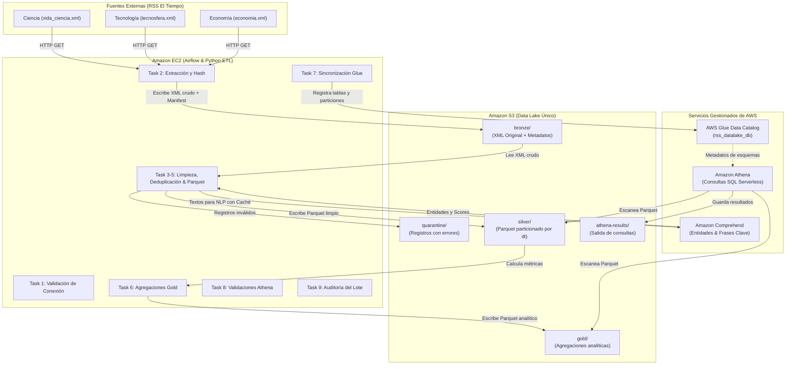

# Arquitectura del Data Lake Medallón para Noticias RSS

## 1. Visión General

El proyecto implementa una arquitectura de Data Lake tipo Medallón (Bronze, Silver, Gold) sobre Amazon Web Services (AWS) para recopilar, procesar, enriquecer y consultar noticias provenientes de los feeds RSS del periódico **El Tiempo**.

Todo el ciclo de vida del dato se orquesta mediante **Apache Airflow** desplegado sobre una instancia **Amazon EC2** con contenedores Docker. El almacenamiento físico se centraliza en un **único bucket de Amazon S3** con separación lógica por prefijos.

---

## 2. Capas del Data Lake (Single Bucket Architecture)

1. **Bronze (`bronze/`)**:
   - Almacena el payload XML original recibido de cada feed RSS sin ninguna modificación estructural.
   - Guarda un archivo manifiesto JSON con la metadata del lote: `run_id`, URL consultada, fecha y hora UTC, código de estado HTTP, hash SHA-256 del contenido y cantidad de registros detectados.
   - Permite la reproducibilidad completa y el reprocesamiento sin volver a consumir los servidores del medio de comunicación.

2. **Silver (`silver/`)**:
   - Datos estructurados, limpiados, normalizados y deduplicados en formato columnar **Parquet** con compresión Snappy.
   - Enriquecidos con **Amazon Comprehend** para detectar personas, organizaciones, lugares y frases clave.
   - Tablas resultantes:
     - `silver_news`: Una fila por noticia vigente.
     - `silver_news_entities`: Una fila por entidad única detectada por noticia vigente.
     - `silver_news_key_phrases`: Una fila por frase clave única detectada por noticia vigente.
   - Particionamiento físico en S3 mediante la convención Hive: `dt=YYYY-MM-DD`.

3. **Cuarentena (`quarantine/`)**:
   - Registros defectuosos (XML malformado, ausencia de título o enlace).
   - Registra el motivo del rechazo y trazabilidad hacia el lote de Bronze.

4. **Gold (`gold/`)**:
   - Modelos analíticos preagregados y optimizados para responder directamente a las preguntas de negocio.
   - Formato Parquet particionado por `dt=YYYY-MM-DD`.
   - Tablas resultantes:
     - `gold_news_by_day`: Volumen de noticias por día, medio y sección.
     - `gold_top_entities`: Ranking de personas, organizaciones y ubicaciones presentes en más noticias distintas.
     - `gold_top_key_phrases`: Frecuencia de frases clave agrupadas por sección.
     - `gold_entity_trend`: Evolución diaria de mención de entidades clave.

5. **Resultados Athena (`athena-results/`)**:
   - Espacio dedicado para que Amazon Athena almacene los resultados de las consultas analíticas y DDL sin contaminar las capas analíticas.

---

## 3. Seguridad y Despliegue sin Secretos

- Toda la infraestructura está codificada en **Terraform**.
- **Cero llaves AWS quemadas**: La máquina EC2 utiliza un **IAM Instance Profile** (`aws_iam_instance_profile`) con permisos mínimos (Principio de Menor Privilegio) para acceder a S3, Comprehend, Glue y Athena.
- El bucket S3 tiene bloqueo total de acceso público (`aws_s3_bucket_public_access_block`) y encriptación en reposo del lado del servidor (`AES256`).
